# Hi there, I'm Michael 👋

I build software end to end: Rails apps, Go services, Cloudflare Workers, and most recently an iPhone game in Swift. Most of it runs on the Unraid server in my house, and nowadays most of it is built with help from AI agents, with security designed in from the start. I design the workflow, write the skills and guardrails, and run teams of agent sessions that turn GitHub issues into shipped features.

## 🤖 Building with AI

I treat AI coding agents as a team to direct, not autocomplete:

- **Multi-agent orchestration**: An orchestrator session plans the work and hands GitHub issues to worker sessions. It picks a model and effort level per task, and coordinates shared resources like the test phone and Xcode.
- **Custom skills and guardrails**: Project-specific Claude Code skills (deploys, dependency reviews, issue swarms) and hooks that block risky edits, such as writes to existing database migrations.
- **Spec-driven development**: Design specs, mockups, and implementation plans are checked into the repo before code is written, so agents build against a reviewed design.
- **Agent environment as code**: My Claude Code and Codex setup is declared in Nix [dotfiles](https://github.com/mmenanno/dotfiles), including shared MCP servers, permission allow/ask/deny lists, skills, and per-machine differences.

## 🔒 Security First

Security is part of how I build, not a final pass:

- **Secrets handled properly**: Credentials are encrypted at rest with Active Record encryption, with key management and rotation built into the app. Machine secrets come from 1Password, never from the repo.
- **Careful auth**: Invite-only accounts with one-time passwords, and HMAC-signed sessions that can be revoked per user.
- **Private by default**: Self-hosted apps stay on the home LAN or a Tailscale tailnet instead of the open internet.
- **Checks in CI**: My main Rails apps run Brakeman security scans and strict RuboCop rules in CI.
- **Agents with limits**: AI agents get explicit permission lists and hooks, so risky actions need my approval or are blocked.

## 🔨 What I'm Working On

These are private for now:

- **Mycelium**: A calm idle game for iPhone where every visual is drawn in code with Metal. I'm building it solo, with Claude agents doing the implementation.
- **Darkroom**: A self-hosted Rails PWA for family photos and videos, with face recognition (pgvector), shared household libraries, and automatic ingest from iCloud and Syncthing.
- **Porthole**: An always-on server dashboard for the office TV. Headless Chromium renders it, the iGPU encodes it to live HLS, and a sideloaded Roku channel plays it.
- **Homebase**: Family scheduling across Apple and Google calendars over CalDAV, with recurring chore assignment.
- **Home server platform**: The automation and docs behind my home server, including a Rails app and a docs site on Cloudflare Workers and D1.

## 🚀 Open Source Projects

- **[Reddit Chat Bridge](https://github.com/mmenanno/reddit_chat_bridge)**: Bridges Reddit Chat (Matrix under the hood) into a private Discord server, with a channel per conversation and identity-preserving webhooks
- **[Calendar Hub](https://github.com/mmenanno/calendar_hub)**: Combines ICS feeds and syncs them to Apple Calendar over CalDAV, with mapping and filter rules
- **[Unraid Template Manager](https://github.com/mmenanno/unraid_template_manager)**: Compares your Unraid Docker templates with Community Applications so you can review changes field by field
- **[GasMoney](https://github.com/mmenanno/gasmoney)**: Gas trip cost calculator with GasBuddy auto-sync
- **[dotfiles](https://github.com/mmenanno/dotfiles)**: Declarative macOS setup with nix-darwin, Home Manager, and 1Password secrets, for personal and work machines
- **[lunchmoney gem](https://rubygems.org/gems/lunchmoney)**: Ruby API client for [LunchMoney](https://lunchmoney.app/)

## Languages and Tools

## GitHub Stats & Activity

## ☕ Support My Work

